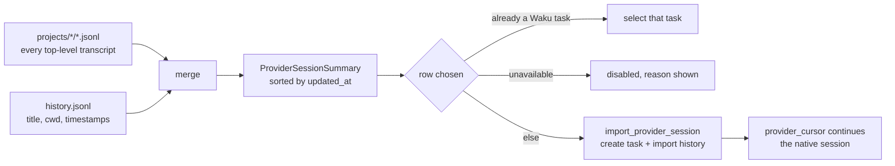

# Provider session history

The right panel's History surface lists the native conversations a coding agent
already holds on this machine — including ones started outside Waku — and lets
the user continue one as a Waku task.

## What already exists

Most of the machinery predates this surface, and the design leans on it rather
than rebuilding it.

`ProviderSessionSummary` ([model.rs](../crates/waku-protocol/src/model.rs)) is
deliberately lightweight — cursor, title, cwd, timestamps — so a list of
hundreds of sessions crosses the daemon protocol without moving their
transcripts. `ProviderSessionHistory` carries the displayable messages and turns
and is fetched only after the user picks one.

`ProviderResumeCursor` is a tagged enum with one variant per provider (`Claude`,
`Codex`, `Amp`, `Cursor`, `OpenCode`, `DeepSeek`, `Fx`, `Grok`, `Kimi`, …), and
`list_provider_sessions` dispatches per provider on the daemon
([daemon.rs](../crates/waku-core/src/daemon.rs)). That match is exhaustive, so a
new provider is a compile error until it gains a lister.

Resuming already works through `import_provider_session`
([command_palette.rs](../src/app/command_palette.rs)): an existing Waku task
with the same cursor is selected instead of duplicated, and otherwise a task is
created whose `provider_cursor` points at the native session, with the imported
history shown. The next prompt continues that conversation.

## The gap this surface closes

Claude's listing preferred `~/.claude/history.jsonl` and returned the
**intersection** of that index with the transcripts on disk. But `history.jsonl`
is the *interactive CLI's* index: headless `-p` runs — which is how Waku starts
Claude — never write to it. The intersection therefore listed terminal sessions
and silently dropped every session Waku itself created.

The listing is now a **union**: every top-level transcript under
`~/.claude/projects/<project>/` is a candidate, and `history.jsonl` is used only
to enrich it with a better title, working directory, and timestamps.
Sub-agent transcripts stay excluded, as before.

## Availability instead of omission

A session whose recorded working directory no longer exists cannot be resumed,
but hiding it is what made the original behaviour confusing. Such sessions are
listed with `unavailable` set on the summary, and the client disables the row
and names the reason. `cwd` keeps the path the provider recorded even when it is
gone, so the row still says where the conversation happened.

The reason is an enum rather than a string so each client translates it.

## Data flow

## Costs and constraints

Listing walks every project directory and reads the head and tail of each
transcript (`SUMMARY_EDGE_BYTES`), never the whole file. It is I/O, so it runs on
the background executor with the result stored on the entity and a generation
counter guarding against a stale pass overwriting a newer one — the same shape
as the other provider listings. The panel must not rescan on every frame or
focus change; it refreshes when opened, on demand, and no more often than a
fixed interval while visible.

Provider-private content stays out. `ProviderSessionHistory` already carries only
what is displayable, and that boundary is not widened by this surface.

## Adding another harness

No UI change is needed. A new provider means:

1. a `ProviderResumeCursor` variant,
2. a `list_provider_sessions` implementation that returns summaries,
3. a `daemon.rs` dispatch arm (the exhaustive match enforces this),
4. i18n keys for any provider-specific availability reason.

The surface reads only the common summary fields and groups by
`cursor.provider()`, so it must never branch on a specific provider.
